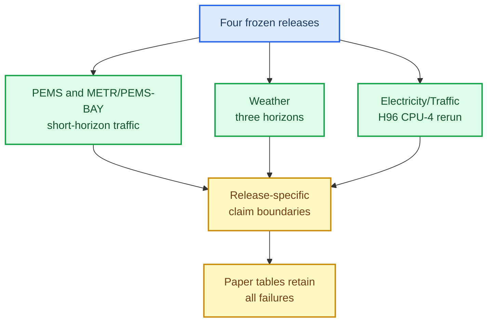

# Held-out evidence matrix for AutoCon MambaTS

_Cross-release evidence inventory for human review; metrics remain in each immutable machine readout._

---

## 📊 Release coverage

Each row is a separate frozen release. The rows must not be pooled into one mean because the datasets, horizons, candidate variants, baseline sets, and sometimes the prediction path differ.

| Release | Datasets | Horizon(s) | Candidate variant | Registered baseline cells | Non-inferior cells | Evidence boundary |
| --- | --- | ---: | --- | ---: | ---: | --- |
| PEMS d24 | PEMS03/04/07/08 | H12 | MambaTSv3AutoCon, d24 | 28 | 28/28 | Short-horizon traffic only |
| METR-LA/PEMS-BAY fusion | METR-LA, PEMS-BAY | H12 | MambaTSv3AutoCon with prediction-connected fusion | 12 | 12/12 | Non-graph traffic; fusion-specific |
| Weather | Weather | H96/H336/H720 | MambaTSv3AutoCon | 12 | 12/12 | Weather-only; multiple horizons |
| Electricity/Traffic CPU-4 | Electricity, Traffic | H96 | MambaTSv3AutoCon, relation auxiliary only | 14 | 13/14 | One Traffic/iTransformer failure cell |

## 🔗 Machine readouts

- [PEMS d24 readout](../../artifacts/paper_final/pems_mambatsv3_d24_test_release_20260926/readout/readout.md)
- [METR-LA/PEMS-BAY fusion readout](../../artifacts/paper_final/metro_pemsbay_mambatsv3_repr_fusion_h12_test_release_20260927/readout/readout.md)
- [Weather readout](../../artifacts/paper_final/mambatsv3_weather_test_release_20260922/readout/readout.md)
- [Electricity/Traffic CPU-4 readout](../../artifacts/paper_final/mambatsv3_stride24_relation_auxiliary_highdim_cpu4_test_release_20261001/readout/readout.md)

## ⚠️ Interpretation limits

The four releases provide broad replication evidence, but they do not prove one universal architecture wins every time-series problem. The candidate is not always the fastest model: linear baselines remain faster on many shapes, and the CPU-4 Electricity/Traffic resource measurement is comparator-specific. AutoCon participation is verified in the registered candidate logs, but these releases are not a global causal ablation of the relation loss. A paper should report the candidate variant, baseline set, horizon, seed count, and failure cells per release.
