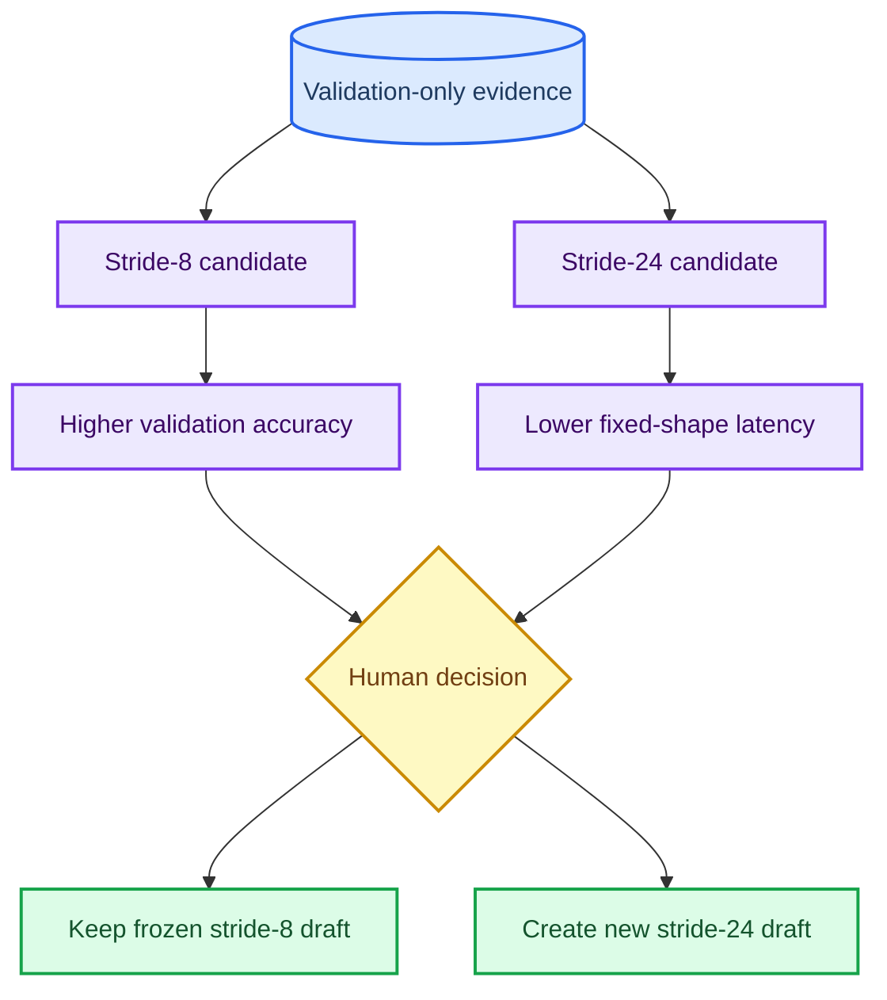

# High-dimensional candidate tradeoff review

_Human decision record, 2026-10-01. This compares completed validation-only and resource-only evidence; it does not authorize a held-out run or replace a frozen plan._

---

## Decision context

Two AutoCon-connected MambaTSv3 candidates have completed same-source Electricity/Traffic H96 validation matrices. Both use one Mamba-1 scan, MeanStd normalization, `d_model=32`, `d_ff=64`, `AutoCon_lambda=.001`, disabled prediction-connected fusion, and the train-only representation objective. Their immutable validation source-tree SHA-256 is `1e3976666f8971abe3bf884f2635bbaf57f522d327201f183647544a666a63a5`.

The existing unapproved held-out draft binds the denser stride-8 candidate. The stride-24 candidate is a distinct, faster architecture selected from an independent validation-only matrix. It cannot be substituted into that draft without creating and approving a new immutable plan.

## Validation and resource comparison

| Dataset | Candidate | Validation MSE | Strongest registered baseline margin | Paired validation wins | Current-source median latency | Candidate interpretation |
| --- | --- | ---: | ---: | ---: | ---: | --- |
| Electricity H96 | Stride-8 relation-only | `.158235` | `-6.117%` versus TimesNet | `3/3` against all 7 baselines | `.80166 ms` | Accuracy-oriented frozen candidate |
| Electricity H96 | Stride-24 relation-only | `.163764` | `-3.438%` versus TimesNet | `3/3` against all 6 registered baselines | `.38858 ms` | `3.494%` higher MSE, `51.529%` lower latency than stride-8 |
| Traffic H96 | Stride-8 relation-only | `.372924` | `-7.029%` versus iTransformer | `3/3` against all 7 baselines | `2.20709 ms` | Accuracy-oriented frozen candidate |
| Traffic H96 | Stride-24 relation-only | `.384616` | `-4.332%` versus iTransformer | `3/3` against all 6 registered baselines | `.83901 ms` | `3.135%` higher MSE, `61.986%` lower latency than stride-8 |

Negative baseline margins favor the MambaTS candidate. Latencies use `B=32,L=96,H=96` device-resident FP32 forwards on RTX 5090 D; they are not training-throughput or hardware-independent measurements.

## Evidence boundaries

| Candidate | Validation evidence | Resource evidence | Held-out status |
| --- | --- | --- | --- |
| Stride-8 | 48 rows, 14 paired cells, seven baselines, all test artifacts rejected | Faster than PatchTST/TimesNet but slower than linear, iTransformer and Mamba2 at the measured shapes | Existing `86`-job draft only; `execution.authorized=false` |
| Stride-24 | 42 rows, 12 paired cells, six baselines, all test artifacts rejected | Faster than PatchTST/TimesNet/Mamba2 in both domains; slower than DLinear and one of iTransformer/Mamba-1 by domain | No held-out draft; no test task may be created from this record without separate approval |

The stride-24 candidate does not establish a universal efficiency advantage. Its value is a narrower accuracy-latency Pareto point: it remains validation-competitive while substantially reducing the cost of the high-dimensional shared scan.

The stride-24 candidate's six validation jobs also have a direct AutoCon participation audit: finite nonzero contrastive loss, `effective_lambda=.001`, and maximum training-loss identity residual `9.61e-10`. This verifies that the required train-time representation objective participated; it does not establish an independent causal accuracy benefit.

The current default Mamba-1 stride-24 path is semantically equivalent to the immutable validation snapshot: state and prediction hashes match exactly under a deterministic CUDA probe, and representation maximum absolute difference is `3.5763e-7`, within the accepted `2e-6` FP32 interpolation-equivalence tolerance.

## Human decision required

1. Keep the existing stride-8 draft if the priority is the stronger validation accuracy margin against all seven baselines.
2. The stride-24 held-out plan is now authorized at [`mambatsv3_stride24_relation_auxiliary_highdim_test_release_draft_20261001.json`](mambatsv3_stride24_relation_auxiliary_highdim_test_release_draft_20261001.json), SHA-256 `49ff3b8ce004487a4e1b88c0463a1a06f39d23b71af034b4f321595a3250aa98`, through its [authorization sidecar](mambatsv3_stride24_relation_auxiliary_highdim_test_release_20261001_launch_authorization.json). The authorization is restricted to its registered 86 jobs and GPU thermal/fan guardrails; no test artifact may select a candidate or change the protocol.
3. Do not combine the two candidates, choose by held-out metrics, or treat either validation matrix as held-out evidence.

## Sources

- [Stride-8 validation readout](../../artifacts/exploratory/mambatsv3_highdim_relation_auxiliary_only_h96_validation_20260928/readout/readout.md)
- [Stride-24 full validation readout](../../artifacts/exploratory/mambatsv3_stride24_full_baseline_h96_validation_20260929/readout/readout.md)
- [Stride-24 resource attestation](../../artifacts/exploratory/mambatsv3_stride24_full_baseline_resource_20260929/readout/readout.md)
- [Current stride-24 resource preflight](../../artifacts/exploratory/mambatsv3_stride24_highdim_resource_preflight_20261001/electricity/model_resources.json)
- [Stride-24 high-dimensional AutoCon audit](../../artifacts/exploratory/mambatsv3_stride24_highdim_autocon_training_audit_20261001/readout/readout.md)
- [Stride-24 default-path equivalence audit](../../artifacts/exploratory/mambatsv3_stride24_default_path_equivalence_20261001/readout.md)
- [Existing stride-8 held-out review](highdim_heldout_review_20260929.md)
