# 训练前缀自相关引导的对比预训练用于低标签传感器时间序列预测

_内部中文初稿，2026-10-12。基于已审计的 local-cluster 证据线；不含作者、单位、基金、伦理、数据可用性、投稿期刊或最终参考文献声明。_

---

## 摘要

低标签时间序列预测需要从源域提取可迁移结构，但常规预测预训练难以区分有用周期关系与不相关样本配对。本文研究一个受限问题：能否只利用源数据训练前缀中的自相关结构，构造预测层面的对比监督，从而改善周期性传感器序列的低标签迁移预测，并且不增加部署时的状态空间扫描次数。方法采用通道数无关的单扫描 Mamba-1 patch encoder，在源域执行残差 next-patch 预测；训练前缀的有符号自相关峰值定义 local contrastive cluster，并在预测未来残差上施加 signed InfoNCE。active 与 exact-null 共享源池、初始化、窗口、预测头、目标微调和随机种子，唯一差异为 relation objective 的权重。预测阶段只执行一次 Mamba scan，不计算 relation loss，也不输出对比表征。 [claim:C101] [evidence:E101]

六个三 seed held-out active/null 坐标中，active 均为 `3/3` 胜出：PEMS-BAY H192 的 10% 和 25% 标签分别改善 `1.425%` 与 `1.115%`，PEMS-BAY H336 的 10% 标签改善 `0.908%`，METR-LA H192 的 10% 和 25% 标签分别改善 `0.169%` 与 `0.304%`，Weather H192 的 10% 标签改善 `0.211%`。 [claim:C102] [evidence:E101] 独立主机在 PEMS-BAY、METR-LA 和 Weather 的 H192/10% 上复现了 active/null 的改善方向，但效应不跨域合并。 [claim:C109] [evidence:E103] 结果支持条件性结论：训练前缀 ACF 引导的预测级对比预训练可在本文命名的周期性、低标签传感器坐标上带来小幅且可复现的迁移收益；该结论不推广为通用时间序列优势。 [claim:C107] [evidence:E101]

**关键词：** 时间序列预测；低标签迁移；自监督学习；自相关；对比学习；Mamba

## 1. 引言

跨域时间序列预测中，目标域标签有限时，源域预训练是否有效取决于源域与目标域的动态相容性，而不只取决于模型容量。本文的核心问题不是“某一主干是否普遍优于其他预测器”，而是训练前缀中估计的周期性自相关能否在不访问验证集或测试集的条件下，成为改善低标签预测的训练信号。

自监督对比学习已被用于长期时间序列预测，其中预测任务与辅助关系任务可以共同优化。[^1] Mamba 状态空间模型提供了时间编码器的一种选择。[^2] 但这些思想本身不能保证自相关关系能跨域迁移：周期强度、有效滞后和 source-target 结构均可能不同。因此，仅报告“加入辅助损失后准确率提高”不能说明 ACF 机制有效；需要与仅移除 relation objective 的 exact-null 对照比较。

本文贡献如下。

1. 提出训练前缀 ACF 驱动的预测级 signed InfoNCE：它在源域预测残差上定义正负关系，而非在部署时添加自相关模块。
2. 采用 active/exact-null 设计，固定其余训练与迁移因素，以隔离 relation objective 的效应。 [claim:C101] [evidence:E101]
3. 在六个 held-out 低标签坐标报告三 seed 机制结果，并报告独立主机三目标域方向复现。 [claim:C102] [evidence:E101] [claim:C109] [evidence:E103]
4. 保留负结果与效率边界，不将特定周期性传感器任务上的结果夸大为普适结论。 [claim:C105] [evidence:E101] [claim:C107] [evidence:E101]

## 2. 方法

### 2.1 低标签迁移设置

给定源域集合 \(\mathcal{S}\) 和目标域序列 \(\mathcal{T}\)，所有 ACF 统计量仅由源域 chronological training prefix 估计。目标域只使用规定比例的训练前缀进行微调；验证集用于 checkpoint 选择，测试集只在选择完成后由只读评估器访问。本文以 seed 为重复单位，不将重叠滑动窗口当作独立统计样本。 [claim:C101] [evidence:E101]

对输入窗口 \(x_{t-L+1:t}\)，模型预测未来 \(H\) 步残差轨迹 \(\hat r_{t+1:t+H}\)。残差预测、标准化、窗口和预测头合同均由冻结工件记录。 [claim:C101] [evidence:E101]

### 2.2 单扫描预测路径

输入经过 patch embedding 后送入一个共享的 temporal Mamba-1 scan。编码状态进入残差预测头，并与线性主预测路径组合。选定部署路径只包含一个 Mamba scan；contrastive representation 不作为预测输出，relation loss 不在推理阶段计算。 [claim:C101] [evidence:E101]

```mermaid
flowchart LR
    accTitle: Local-cluster ACF-InfoNCE workflow
    accDescr: Source training prefixes generate signed ACF pair relations for an auxiliary training objective. Target adaptation and deployment use the shared one-scan encoder; deployment excludes pair construction and relation loss.

    source_prefix["Source training prefixes"] --> acf_pairs["Signed ACF lag pairs"]
    source_prefix --> patches["Patch windows"]
    patches --> encoder["One Mamba-1 scan"]
    encoder --> residual_head["Residual next-patch predictor"]
    acf_pairs --> infonce["Forecast-level signed InfoNCE"]
    residual_head --> infonce
    residual_head --> source_loss["Source prediction loss"]
    source_loss --> pretrained["Pretrained shared encoder"]
    infonce --> pretrained
    pretrained --> target_adapt["Low-label target adaptation"]
    target_adapt --> deployment["Prediction-only deployment"]

    classDef data fill:#dbeafe,stroke:#2563eb,stroke-width:2px,color:#1e3a5f
    classDef train fill:#fef9c3,stroke:#ca8a04,stroke-width:2px,color:#713f12
    classDef deploy fill:#dcfce7,stroke:#16a34a,stroke-width:2px,color:#14532d

    class source_prefix,patches data
    class acf_pairs,infonce,source_loss,pretrained,target_adapt train
    class deployment deploy
```



*图 1：训练阶段利用源训练前缀 ACF 构造辅助关系；部署阶段仅执行预测路径。*

### 2.3 有符号 ACF 对比目标

对于训练前缀的候选滞后 \(\ell\)，令 \(a_\ell\) 表示其 ACF 的符号和强度描述。local-cluster 规则在合法滞后邻域内构造候选窗口对，并通过 channel-coverage 条件排除仅由少数通道支持的关系。对预测残差表征 \(z_i\)，辅助损失概念化为：

\[
\mathcal{L}_{rel}=-\sum_i\log\frac{\sum_{j\in\mathcal{P}(i)}\exp(s_{ij}/\tau)}{\sum_{k\in\mathcal{P}(i)\cup\mathcal{N}(i)}\exp(s_{ik}/\tau)},
\]

其中 \(\mathcal{P}(i)\) 和 \(\mathcal{N}(i)\) 由训练前缀 ACF 的有符号关系确定，\(s_{ij}\) 是预测轨迹的关系分数。总损失为 \(\mathcal{L}_{pred}+\lambda\mathcal{L}_{rel}\)。exact-null 将 relation 权重设为零，但保留相同窗口、source prediction objective、初始化和目标域适配。 [claim:C101] [evidence:E101]

### 2.4 证据层级

| 层级 | 比较 | 用途 | 是否构成主机制结论 |
| --- | --- | --- | --- |
| 主机制证据 | active vs exact-null | 固定其他因素，仅改变 relation objective | 是 |
| 独立复现 | 新主机、新 seed、相同协议 | 检查方向的环境与目标域可复现性 | 支持但不合并效应量 |
| 外部基线扩展 | active vs pinned official PatchTST | 检查外部模型对照 | 否，后加描述性扩展 |

该分层避免将 post-release 外部基线或 validation-only robustness 写成原始 active/null 机制比较。 [claim:C106] [evidence:E101]

## 3. 实验设计

### 3.1 数据与坐标

主机制实验覆盖 PEMS-BAY、METR-LA 和 Weather。报告坐标为 PEMS-BAY H192/10%、H192/25%、H336/10%，METR-LA H192/10%、H192/25%，以及 Weather H192/10%。每个坐标使用三个 paired seed，并按 chronological split 执行 validation-first checkpoint 选择。 [claim:C102] [evidence:E101]

### 3.2 评价与主干决策

主指标为测试 MSE。对每个坐标报告三个 seed 的均值、active/null 胜出数量和相对变化；独立主机复现还报告 one-standard-error 上界，仅作小样本不确定性描述，不跨域汇总。 [claim:C109] [evidence:E103]

最终主干为 MambaTSv3 的 Mamba-1 mixer。Mamba-2 仅为 validation-only 架构消融；v13 推广门控失败，v14--v16 与官方 Mamba-3 因资源门槛停止，Mamba-3 的官方预检延迟为 Mamba-1 的 `2.03x`。 [claim:C105] [evidence:E101]

## 4. 结果

### 4.1 Held-out active/null 机制结果

表 1 为主机制结果。六个坐标中 active 均低于 exact-null，且每个坐标均为 `3/3` seed 胜出。效应从 METR-LA H192/10% 的 `-0.169%` 到 PEMS-BAY H192/10% 的 `-1.425%`，显示收益依赖数据集和标签比例。 [claim:C102] [evidence:E101]

| 目标域 | Horizon | 标签比例 | Active MSE | Exact-null MSE | 相对变化 | Active 胜出 |
| --- | ---: | ---: | ---: | ---: | ---: | ---: |
| PEMS-BAY | 192 | 10% | 2.635171 | 2.673272 | -1.425% | 3/3 |
| PEMS-BAY | 192 | 25% | 2.273256 | 2.298880 | -1.115% | 3/3 |
| PEMS-BAY | 336 | 10% | 2.289701 | 2.310690 | -0.908% | 3/3 |
| METR-LA | 192 | 10% | 2.618048 | 2.622484 | -0.169% | 3/3 |
| METR-LA | 192 | 25% | 1.931659 | 1.937556 | -0.304% | 3/3 |
| Weather | 192 | 10% | 1.017754 | 1.019903 | -0.211% | 3/3 |

*表 1：local-cluster ACF-InfoNCE 的主 held-out active/exact-null 比较。 [claim:C102] [evidence:E101]*

PEMS-BAY H336 是独立 seed 集合，表明正向关系不只出现在 H192。 [claim:C103] [evidence:E101]

### 4.2 独立主机复现

表 2 给出独立 RTX 3060 Ti 主机上的三域复现。三个目标均为 active `3/3` 胜过 null，one-SE 上界低于 1。由于目标数据生成过程和指标尺度不同，本文不对效应量进行 pooled estimate。 [claim:C109] [evidence:E103]

| 目标域 | 标签比例 | Active MSE | Null MSE | 相对变化 | 胜出 | One-SE 上界 |
| --- | ---: | ---: | ---: | ---: | ---: | ---: |
| PEMS-BAY H192 | 10% | 2.638441 | 2.670296 | -1.193% | 3/3 | 0.99151 |
| METR-LA H192 | 10% | 2.622863 | 2.630788 | -0.301% | 3/3 | 0.99762 |
| Weather H192 | 10% | 1.016437 | 1.017655 | -0.120% | 3/3 | 0.99903 |

*表 2：独立主机 active/null 复现；每行独立解释。 [claim:C109] [evidence:E103]*

### 4.3 官方 PatchTST 外部代码扩展

独立主机在 validation selection 后，以锁定 commit 的官方 PatchTST 和本地 chronological adapter 进行只读测试。表 3 中 active 在三个目标域均为 `3/3` 胜出。该扩展在 active/null 协议冻结后完成，支持外部对照的可复现性，但不能反向改变 relation objective 的机制解释。 [claim:C106] [evidence:E101]

| 目标域 | Active MSE | 官方 PatchTST MSE | 相对变化 | Active 胜出 | One-SE 上界 |
| --- | ---: | ---: | ---: | ---: | ---: |
| PEMS-BAY H192/10% | 2.638441 | 2.649355 | -0.412% | 3/3 | 0.99762 |
| METR-LA H192/10% | 2.622863 | 2.727006 | -3.819% | 3/3 | 0.96717 |
| Weather H192/10% | 1.016437 | 1.056680 | -3.809% | 3/3 | 0.96653 |

*表 3：独立主机上的 pinned official PatchTST 后加扩展。 [claim:C106] [evidence:E101]*

### 4.4 鲁棒性与部署边界

在 PEMS-BAY H192、PEMS-BAY H336、METR-LA H192 和 Weather H192 的后确认 validation-only 扩展中，active 在晚期时间段、10%/30% 通道遮蔽和两种相对噪声条件下均保留三 seed 优势。这些结果是冻结 checkpoint 的闭合扰动评估，不是新增 held-out 主结果。 [claim:C104] [evidence:E101]

PEMS-BAY H336 部署 checkpoint 保持单次 Mamba scan 且不计算 relation loss。与相同形状的官方 PatchTST 相比，active 峰值 allocated memory 更低，但中位推理延迟高 `24.35%`；因此本文只主张训练-部署解耦，不主张通用速度优势。 [claim:C105] [evidence:E101]

## 5. 讨论

### 5.1 科学解释

结果支持的解释是：在部分周期性且 source-target 动态相容的低标签传感器坐标中，训练前缀 ACF 构造的关系为预测残差学习提供了有用辅助约束。这个解释来自 active/exact-null 单因素差异，而非外部基线差异。 [claim:C101] [evidence:E101]

但 ACF 不是充分条件。训练前缀 compatibility 分析在五个目标点呈现描述性相关，然而 PEMS03 的高 compatibility 验证门控未完全通过。因此 compatibility 只能作为风险信号，不能作为确定性的 source-selection 法则。 [claim:C108] [evidence:E102]

### 5.2 负边界和局限性

Electricity H96/25% 与 Traffic H96/25% 的 active 分别退化 `2.146%` 与 `0.263%`；Weather H192/25% 和 PEMS03 H192/10% 也未通过所有 seed 的验证门控。 [claim:C107] [evidence:E101] 这表明当前 ACF relation objective 不是通用自监督预测器。

本文还有四项限制：每个主坐标仅三个 seed；独立复现来自同一独立主机的三个不同域；官方 PatchTST 是 post-release extension；证据集中于命名周期传感器域。以上限制要求将结果定位为条件性机制研究，而非通用 forecasting SOTA。 [claim:C106] [evidence:E101] [claim:C107] [evidence:E101]

### 5.3 研究意义

本研究的价值不在于宣称所有预测任务均显著提升，而在于提供可检验的实验范式：将 train-prefix ACF 从描述统计量转为预测级自监督关系；用 exact-null 而非仅外部基线测试其机制；把独立主机复现、外部代码扩展和负边界分层报告；并保持部署路径不含 relation loss 或额外 Mamba scan。

## 6. 结论

本文提出并检验了训练前缀 ACF 引导的预测级对比预训练协议。它在六个低标签 held-out active/exact-null 坐标上取得方向一致的三 seed 改善，并在独立主机的 PEMS-BAY、METR-LA 与 Weather H192/10% 上复现 active/null 改善方向。 [claim:C102] [evidence:E101] [claim:C109] [evidence:E103]

最严格的结论是：对于本文指定的周期性低标签传感器预测坐标，signed forecast-level ACF InfoNCE 可以作为单扫描 Mamba 迁移预测的训练期辅助信号；它不在推理阶段引入额外 relation loss 或额外 Mamba scan。 [claim:C101] [evidence:E101] 该结论不涵盖 Electricity、Traffic 或其他未验证时间序列域。后续工作应在预先冻结的新增域集合上检验 compatibility 风险信号，并扩大 seed 与独立环境数量。

## 附录 A：实验可复验性

以下命令重建派生审计、主干选择、源码/数据漂移审计与 review manifest；它不启动训练，也不读取新的测试数据：

```bash
python scripts/verify_final_local_cluster_evidence.py
```

## 参考文献

> **待作者核验与按目标期刊格式统一。** 以下仅列出本稿背景段已引用的本地已记录条目，不代表最终参考文献表。

[^1]: Park, J., Gwak, D., Choo, J., and Choi, E. (2024). Self-Supervised Contrastive Learning for Long-term Forecasting. _International Conference on Learning Representations_. https://openreview.net/forum?id=nBCuRzjqK7

[^2]: Cai, X., Zhu, Y., Wang, X., and Yao, Y. (2024). MambaTS: Improved Selective State Space Models for Long-term Time Series Forecasting. _arXiv_. https://arxiv.org/abs/2405.16440
