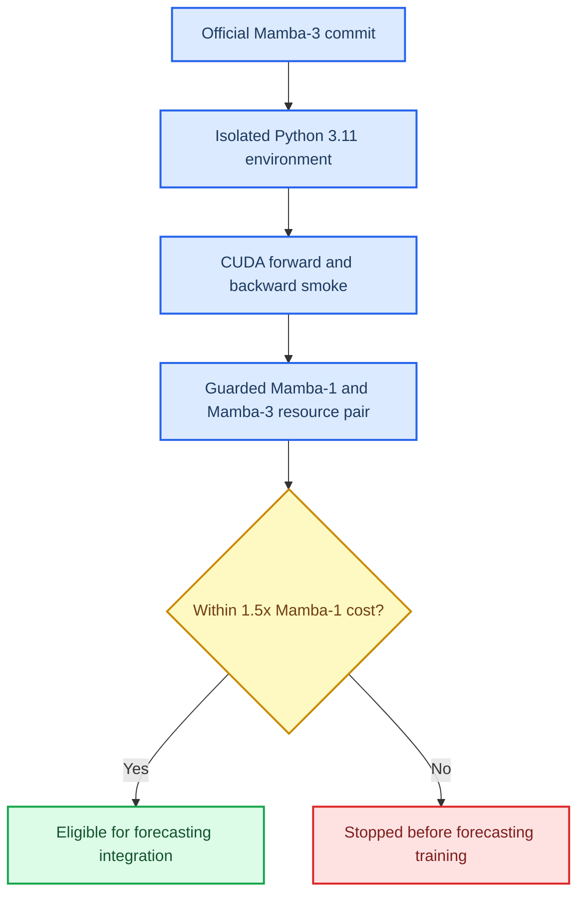

# Mamba-3 Backbone Resource Preflight

_Official Mamba-3 compatibility and resource decision, 2026-10-08_

---

## Context

The active forecasting evidence uses a one-scan MambaTSv3 Mamba-1 core. Earlier
Mamba-2 exploration was slower and did not provide a replacement main model.
Mamba-3 is now present in the official `state-spaces/mamba` repository, but it
requires a newer Python/Triton/TileLang stack than the frozen Mamba-1 evidence
environment.[^1] This record asks only whether a Mamba-3 block clears a resource
gate before any forecasting integration or data training.

## Preflight flow

## Fixed resource contract

| Field | Value |
| --- | --- |
| Official source | `state-spaces/mamba` commit `e9594ce1c732d97440f0332fdc43170a2294dbfa` |
| Candidate runtime | Isolated Python 3.11, PyTorch `2.10.0+cu128`, `mamba_ssm 2.3.2.post1` |
| Mamba-3 block | `d_model=24`, `d_state=16`, `headdim=24`, SISO, `chunk_size=32` |
| Mamba-1 control | `d_model=24`, `d_state=8`, `d_conv=2`, `expand=1` |
| Input shape | `[1300, 4, 24]`, matching `B=4`, `C=325`, four 24-point patch tokens |
| Timing | Device-resident FP32, 25 warm-up and 100 timed prediction-only forwards |
| Thermal guard | Temperature `<=78C`, fan `<=85%` |
| Stop rule | Stop before forecasting training if Mamba-3 median latency or peak memory exceeds `1.5x` Mamba-1 |

## Result

The official Mamba-3 import and CUDA forward/backward smoke completed with
finite outputs and gradients in the isolated environment. The guarded resource
pair recorded no thermal or fan trigger. The machine-readable result is
`artifacts/exploratory/mamba3_backbone_preflight_20261008/audit.json`.

| Block | Median forward latency | Peak allocated memory | Decision relevance |
| --- | ---: | ---: | --- |
| Mamba-1 | `0.154 ms` | `15.23 MB` | Resource control |
| Mamba-3 (`d_state=16`) | `0.312 ms` | `21.35 MB` | `2.03x` latency and `1.40x` memory |

Mamba-3 therefore fails the registered resource gate and is stopped before
forecasting training. This is a fixed-shape block preflight, not an end-to-end
forecasting benchmark or an accuracy comparison.

## Consequences

- The frozen Mamba-1 long-horizon signed InfoNCE evidence remains unchanged.
- The isolated Mamba-3 environment is retained for future upstream-compatible
  checks, but is not part of the audited Mamba-1 reproduction environment.
- No Mamba-3 model, checkpoint, validation score, or test metric was produced.
- The TileLang stack emitted import-time third-party registration warnings;
  finite CUDA execution passed, but the warnings are another reason not to
  promote the candidate without a dedicated runtime stability study.

## References

[^1]: Dao AI Lab. (2026). "Mamba SSM architecture." _GitHub_. https://github.com/state-spaces/mamba
