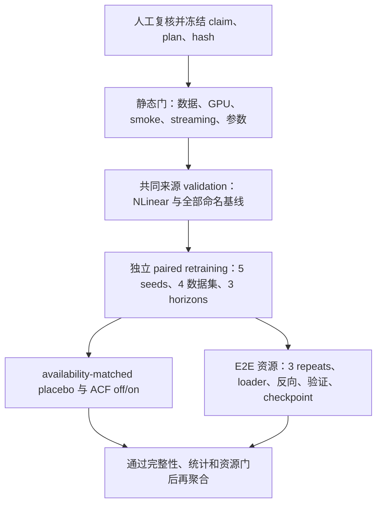

# MambaACF 证据矩阵缺口审计

_人工复核草稿 · 2026-09-03 · 只读审计，不启动训练_

---

> ⚠️ **结论先行：** 当前仓库可以支持“实现已具备、证据审计和机制筛选已完成、效果具有明显数据集依赖”这类工程和探索性表述；不能支持“纯 Mamba 普遍适合时间序列”“MambaACF/AutoCon 已提升或不劣于所有基线”“MambaACF 更快”“ACF 峰值选择具有因果增益”或“完整六基线排行榜”这些论文结论。现有确认计划仍是 `draft_requires_prelaunch_review`，未授权、未启动训练。

本稿只使用仓库内部证据，不替代统计分析，也不构成投稿结论。所有数值都应由作者在冻结计划后重新核对。

## 📋 审计范围与证据等级

### 范围

- 检查当前 benchmark 覆盖、基线完整性、主统计门、资源协议、容量公平性和 ACF placebo/paired-retraining 设计。
- 区分当前已有结果、可复现的工程审计、探索性筛选，以及尚未执行的确认实验。
- 不运行训练、不把后验 replay 或同一 checkpoint 的反事实分支当作独立训练证据。

### 证据分级

| 等级 | 含义 | 本仓库示例 |
| --- | --- | --- |
| A | 计划、来源、完整性或协议可审计，但不等于效果成立 | benchmark audit、confirmation contract |
| B | 已有固定来源的描述性结果，可用于限定范围的观察 | highdim Mamba2/PatchTST、Traffic 通道汇总 |
| C | 探索性或存在混杂/后验选择，不能承担确认性 claim | 3-seed H96 机制筛选、counterfactual replay |

## 🎯 当前可支持与不可支持的 claim

| 拟议 claim | 当前状态 | 证据与限制 | 允许的最强表述 |
| --- | --- | --- | --- |
| Mamba 普遍适合时间序列 | **不支持** | Traffic 的 Mamba2 明显落后，Electricity 混合；跨数据集方向不一致 | “Mamba 的适用性依赖数据集、通道数和任务设置” |
| MambaACF/AutoCon + ACF 提升预测精度 | **不支持** | 仅有 3-seed、H96、探索性筛选；没有当前树、全矩阵、五 seed 的确认结果 | “ACF 关系记忆是待验证的候选机制” |
| 对 PatchTST、Mamba2 不劣 | **尚未支持** | 这是注册的主比较边界，但计划未授权且没有完成的确认结果 | “若未来所有主门通过，只能支持相对于 PatchTST/Mamba2 的窄 claim” |
| 对全部六个基线不劣 | **不支持** | 主统计门只含 PatchTST/Mamba2；历史矩阵全部缺 NLinear，其余基线为描述性行 | “其余基线只能作为描述性参照，不能合并成全基线 claim” |
| MambaACF 更快 | **不支持** | 当前是 device-resident prediction-only 微基准；没有含加载、反向、优化、验证和 checkpoint 的端到端时间 | “需要按注册 E2E 协议重新测量” |
| ACF 峰值选择带来因果增益 | **不支持** | 固定 lag placebo 与峰值的合法可用性分布不匹配，也没有独立 paired retraining | “当前只能观察到分支敏感性，不能归因于峰值选择” |
| Traffic 的 Mamba2 劣势只是少数异常通道造成 | **描述性地不支持** | 862 通道中约 99.1%--99.2% 通道在三个 horizon 都更差；但该汇总为后验 v3，不能提升推断等级 | “劣势广泛分布，需通道保持的确认实验” |

## 📊 已有结果与审计证据

### 基线覆盖和 NLinear 缺口

最新审计显示有 5,882 个配置文件、2,977 个可用 metric artifact，其中 226 个落在已注册 phase root 之外，属于历史或探索性产物（包含本轮三个单 job replay smoke 的输出）。`corrected_confirmatory_S/M`、`confirmatory_core/M`、`secondary_transfer`、`exploratory_ili` 和 `highdim_confirmatory_M` 各 phase 的可用 artifact 均完整，但都标记为缺少 NLinear。基线矩阵要求的最小集合是 `DLinear`、`NLinear`、`PatchTST`、`TimesNet`、`Mamba1`、`Mamba2`；`AutoConNet/MambaACF` 只能作为候选模型或消融，不能替代必需基线。

已有的 NLinear gap screen 只是 ETTh1/Traffic、H96、3 seeds、8 epochs 的 6-job 提案，没有结果目录，也没有授权；历史 NLinear 记录的来源和预算不兼容。因此，单独补这 6 个 job 不能修复既有矩阵，不能支撑完整 baseline claim。

### Mamba2 与 PatchTST 的高维结果

`highdim_confirmatory_M_v3` 的 Traffic 聚合结果如下（MSE 越低越好）：

| Horizon | PatchTST | Mamba2 | Mamba2 相对差异 |
| ---: | ---: | ---: | ---: |
| 96 | 0.501767 | 0.648306 | +29.205% |
| 336 | 0.516942 | 0.623489 | +20.611% |
| 720 | 0.550696 | 0.659914 | +19.833% |

`Mamba2AutoCon` 在 Traffic 上对应为 0.649773、0.623169、0.658317，仍未改变相对 PatchTST 的劣势。Electricity 的三个 horizon 则约为 -0.71%、+1.69%、-4.46%，说明结论具有明显数据依赖。该 v3 结果的完整性检查为 270/270，但其选择绑定为 `prelaunch_replay_of_posthoc_attestation`，`publication_ready=false`；它适合作为方向性和风险证据，不应冒充新鲜的 launch-time confirmatory run。

### Traffic 通道层面的描述性稳健性

Traffic 有 862 个通道。按每个 seed 先做通道宏平均、再以 5 个 seed 配对，不能把 862 个通道当作独立样本。Mamba2 相对于 PatchTST 的方向在三个 horizon 都高度一致：

| Horizon | Mamba2 更低的通道 | Mamba2 更高的通道 | 通道宏平均相对差异 |
| ---: | ---: | ---: | ---: |
| 96 | 8/862 | 854/862 | +29.205% |
| 336 | 8/862 | 854/862 | +20.611% |
| 720 | 7/862 | 855/862 | +19.833% |

5% 对称截尾均值和逐通道 leave-one-out 的方向也保持为正，表明差异不是由少数离群通道解释。该分析仍是后验 v3 的描述性稳健性检查，不能替代按 seed 配对的确认性检验或改变 `publication_ready=false`。

按 seed 先做 862 通道宏平均后再配对（`n=5`），三个 horizon 的 Mamba2-PatchTST 差值 95% CI 分别为 H96 `[0.143681, 0.149397]`、H336 `[0.105508, 0.107585]`、H720 `[0.106140, 0.112295]`。这些区间仅是后验 v3 的描述性补充，不能把通道或 seed 的重复使用升级为新的确认性样本量。

### MambaACF 探索性精度证据

- ETTh1/Traffic H96、3 seeds 的 fair-baseline screen 中，memory arm 相对 PatchTST 的 MSE 为 **+1.912%**；相对 Mamba2 为 **-10.618%**，但外部模型未做参数匹配，且 memory/relation arm 使用了不同的 MambaACF 变体，存在混杂。
- relation null control 的 6 个配对坐标给出 MSE **-0.732%**（MAE -0.821%），但样本很小，仅为探索性描述；关系分支通常位于独立表示路径，不能解释成 forecast-memory 的直接因果效应。
- soft/hard relation target screen 的 pooled MSE 差异为 **+0.146%**，Traffic 为 +0.279%，且 Traffic 0/3 胜出，已触发停止规则。
- 旧 `extension_pilot_20260831` 的 Traffic H96 单 seed、3-epoch pilot 曾报告 MambaACF 0.539017 对 PatchTST 0.565537（773/862 通道更低，-4.689%）。该 pilot 使用不同代码/资源批次，仓库明确禁止与三-seed selector 或当前 v3 工件混合；它只能说明历史结果方向不稳定，不能作为当前 MambaACF 证据。

这些结果可用于提出机制假设和设计后续实验，不能用于声称 ACF 已提高泛化精度。

### 资源和速度证据

当前资源基线采用 RTX 5090 D、PyTorch 2.8.0+cu128、100 次 warmup/300 次计时、device-resident synthetic input、prediction-only（`return_repr=false`）。单位为单次 forward ms：

| 数据集/Batch | DLinear | PatchTST | Mamba1 | Mamba2 | MambaACF AutoCon |
| --- | ---: | ---: | ---: | ---: | ---: |
| ETTh1 / 32 | 0.06685 | 0.28283 | 0.37789 | 0.65765 | 1.40067 |
| Traffic / 1 | 0.05837 | 0.27739 | 0.38667 | 0.67165 | 1.41931 |

在该微基准下，MambaACF AutoCon 约为 Mamba2 的 2.1 倍，且慢于 Mamba1、PatchTST 和 DLinear。它没有测量数据加载、反向传播、优化器、验证、保存或多次重复的端到端 epoch 时间，因此不能转写为“训练更快”或“系统更高效”。确认计划要求至少 50 warmup、200 timed、3 repeats、median/p90、参数/显存，以及含 loader 的 E2E epoch；速度 claim 还必须在准确率门通过后、每个声称的 cell 都比指定 nonlinear comparator 快至少 10%。

### 参数和容量现状

当前资源审计中的总参数/可训练参数为：

| 数据集 | MambaACF AutoCon | Mamba2 | PatchTST |
| --- | ---: | ---: | ---: |
| ETTh1 | 52,757 / 52,724 | 34,067 / 29,907 | 46,080 |
| Traffic | 185,326 / 185,293 | 171,722 / 167,562 | 46,080 |

这些数字来自合成资源配置，是工程审计而非最终确认公平性证明。相同 `d_model` 不代表参数匹配；正式协议要求 launch-time 参数审计，并要求 `MambaACFAutoCon/Mamba2` 的 active trainable parameter ratio 在每个 ETTh1/Traffic H96 cell 不超过 1.5。外部 PatchTST、TimesNet、iTransformer、DLinear、NLinear 未参数匹配，结果不能归因于 Mamba operator 本身。

## 🔍 关键缺口

### NLinear 和共同来源

问题不是“少跑几个数字”，而是当前主矩阵与基线契约不一致。历史 NLinear 产物的代码来源、数据处理或预算不同，不能与当前 Mamba 结果拼表。最小可信修复是冻结新的 common-provenance plan，在同一数据划分、特征、优化器、预算和 seeds 下重新跑完整命名基线；若研究问题只保留 PatchTST/Mamba2 主门，也必须把 NLinear 明确限定为描述性行，而不是事后补成全基线 claim。

### Primary gate 的边界

确认计划把准确率非劣性主比较限定为 `MambaACFAutoCon vs PatchTST` 和 `MambaACFAutoCon vs Mamba2`，另有显存和 combined-vs-peak 的两个资源门。共 12 个 simultaneous cells，采用单侧配对 log-MSE 上界、Bonferroni alpha=0.05/12，并另外报告 Holm p 值；五个 seed 仍是小样本，且非劣性零假设不是等价性证明。DLinear、NLinear、TimesNet、iTransformer、Mamba1 在计划中是 mandatory descriptive rows，不应在结果阶段临时扩大成 all-baseline inferential family。

当前没有任何完成的 confirmation result，计划状态仍为未授权。因此即使未来主门通过，最强结论也只能是相对于预先声明的 PatchTST/Mamba2 的窄 claim。

### 端到端速度缺口

缺少统一的 E2E 定义和实测记录：同一 GPU/驱动、AMP/dtype、batch、序列/预测长度、loader workers、warmup/timing、反向与验证开销、checkpoint 和多次重复尚未形成完整 artifact。需要把“单次 forward 微秒级优势”与“完整 epoch wall-clock 优势”分开报告，避免把合成 prediction-only 结果外推到训练吞吐。

### 容量、公平性和选择偏差

当前 dry audit 的参数比例只能指导配置，不能替代不可变的 launch manifest。需在每个 dataset/horizon 记录 total、active trainable、FLOPs 或等价计算量、显存，并在超出 1.5 ratio 时重新冻结 plan/hash。与此同时，不能用 posthoc 选择后的 v3 artifact、不同源码快照或不同 epoch 预算做“公平比较”。

### ACF placebo 与 paired retraining

固定 placebo lag `[5, 11, 17]` 与峰值 lag 的合法可用性 profile 不匹配：在 `L=96, H=96` 时约暴露 5.2%、11.5%、17.7% 的预测步，而 availability-weighted peak 可覆盖大部分或全部预测步；lag cardinality 相同不能证明可比。正式 null 应实现并单元测试 availability-matched、非峰值 lag matcher，并把算法和容差冻结到新的 plan hash。

此外，同一 checkpoint 的 on/off 分支 replay 只能测 branch sensitivity，不能估计重新训练后的 treatment effect。现有 3-seed H96 screen 也不能替代五 seed、多数据集、多 horizon 的独立 paired retraining；需要相同 seeds、预算和数据划分的 memory-on/off 训练，并以 seed 为配对单位汇总。

## 🧭 最小补齐路径

| 优先级 | 最小动作 | 完成判据 |
| --- | --- | --- |
| P0 | 冻结主 claim 边界和 multiplicity；明确 PatchTST/Mamba2 是否仍为唯一主门 | 新 plan/hash、分析器单元测试、无事后扩大 comparator family |
| P0 | 以共同来源重建验证/基线矩阵，包含 NLinear；禁止只补 6-job screen | 所有命名 rows 有同一 provenance、预算和 split，phase validator 通过 |
| P0 | 运行当前树的 MambaACF confirmation arms | 五 seed、四数据集、H96/336/720，训练与 sidecar 完整，未使用 test 选参 |
| P0 | 补齐 E2E 速度协议 | 3 repeats 的 median/p90、总/active 参数、显存、完整 epoch wall-clock；准确率门先通过 |
| P1 | 做 launch-time capacity audit | 每个 cell 参数/计算量记录；ratio 超限自动阻断或重新冻结计划 |
| P1 | 实现 availability-matched sham 并独立 paired retrain | lag profile 差异在预设容差内；on/off 以 seed 配对而非 checkpoint replay |
| P1 | 对 Traffic 做 channel-preserving 控制和宏平均敏感性分析 | 通道定义、聚合单位、trim/LOO 预注册；不把通道数当样本量 |
| P2 | 固定 relation 分支 telemetry 和 lambda 选择规则 | 覆盖率、active anchors、梯度/损失路径在 sidecar 中可复核 |

## ✅ 人工复核清单

- [ ] 是否批准把论文主 claim 限定为 PatchTST/Mamba2，还是愿意为全基线 claim 重新设计统计家族？
- [ ] 是否批准非劣性 margin（当前计划为 1%）及其 log-MSE 变换、Bonferroni/Holm 规则？
- [ ] 是否批准共同来源的 NLinear 和全命名基线重跑，而不是执行孤立 6-job screen？
- [ ] 是否批准 E2E 的计时边界、重复次数、warmup、loader/backward/validation/checkpoint 组成？
- [ ] 是否批准 availability-matched sham 的 matcher、容差和 paired-retraining 方案？
- [ ] 是否确认本稿本身**不授权训练**；只有冻结的新 plan 和静态门通过后才可启动？

## 🔗 证据索引

| 主题 | 内部证据 |
| --- | --- |
| 最新覆盖与完整性 | [benchmark_audit.md](../../artifacts/benchmark_audit_20260903_final2/benchmark_audit.md) |
| 基线矩阵契约 | [benchmark-matrix.md](./benchmark-matrix.md) |
| 主统计/资源/ACF 合同 | [mamba_acf_confirmation_plan.json](./mamba_acf_confirmation_plan.json)、[mamba_acf_confirmation_protocol.md](./mamba_acf_confirmation_protocol.md) |
| 当前资源微基准 | [mamba_acf_resource_baseline_current_20260902.md](./mamba_acf_resource_baseline_current_20260902.md) |
| NLinear 缺口审查 | [mamba_acf_nlinear_baseline_gap_screen_review_20260902.md](./mamba_acf_nlinear_baseline_gap_screen_review_20260902.md) |
| 高维 Mamba2/PatchTST 聚合 | [summary.csv](../../artifacts/paper_final/corrected/highdim_confirmatory_M_v3/report/summary.csv)、[highdim_confirmatory_M.md](../../artifacts/paper_final/corrected/highdim_confirmatory_M_v3/report/highdim_confirmatory_M.md) |
| Traffic 通道描述性汇总 | [per_channel_summary.csv](../../artifacts/paper_final/corrected/highdim_confirmatory_M_v3/report/per_channel_summary.csv)、[summary_channel_micro.md](../../artifacts/paper_final/corrected/highdim_confirmatory_M_v3/channel_summary/summary_channel_micro.md) |
| 探索性机制筛选 | [fair baseline screen](./mamba_acf_fair_baseline_screen_readout_20260901.md)、[relation null control](./mamba_acf_relation_null_control_readout_20260901.md)、[relation target screen](./mamba_acf_relation_target_screen_readout_20260901.md) |
| 历史 pilot 限制 | [results_evidence_readout.md](./results_evidence_readout.md)、[Traffic H96 pilot raw results](../../artifacts/extension_pilot_20260831/traffic_h96_summary/raw_results.csv) |
| 反事实限制 | [mamba_acf_counterfactual_audit_20260903.md](./mamba_acf_counterfactual_audit_20260903.md) |
| Mamba 总体状态 | [mamba_current_status.md](./mamba_current_status.md) |
