# ACF-InfoNCE Manuscript Outline

_Internal evidence-bound outline for human scientific review. Not for submission._

---

## 📋 Scope and evidence status

The proposed paper concerns channel-count agnostic residual pretraining for
low-data multivariate forecasting. The central training mechanism is signed
forecast-level InfoNCE over train-prefix ACF lag pairs; prediction-only
inference omits pair construction and relation loss. All numeric prose below
is linked to the local source manifest in this document's evidence files.
Those artifacts are machine-audited but still require a human verifier before
this outline can become manuscript text.

The intended claim is scoped to ACF-compatible, periodic traffic and sensor
forecasting. The study record contains negative boundaries for Electricity,
higher target coverage in Traffic and Weather, forecast-affine loss, and
ACF-signature source ranking. None may be removed from a final paper.

## 🧠 Method narrative

```mermaid
flowchart LR
    accTitle: ACF InfoNCE Forecasting Method
    accDescr: Train-prefix source windows are encoded by a channel-count agnostic single Mamba scan, jointly optimized for residual prediction and signed ACF InfoNCE, then exactly transferred to a target residual correction path without inference-time contrastive computation.

    source_prefix[📥 Source train prefixes] --> acf_pairs[🔍 Train-only ACF lag pairs]
    source_prefix --> patch_encoder[⚙️ Shared patch encoder]
    patch_encoder --> mamba_scan[🧠 One MambaTSv3 scan]
    acf_pairs --> infonce[⚙️ Signed InfoNCE]
    mamba_scan --> residual_head[📤 Residual prediction head]
    mamba_scan --> infonce
    residual_head --> exact_head[🔗 Exact H-matched head]
    exact_head --> target_hybrid[⚙️ Target linear primary plus Mamba correction]
    target_hybrid --> prediction[✅ Prediction-only forecast]
    prediction --> deployed[🏁 No pair loss and one Mamba scan]

    classDef source_style fill:#dbeafe,stroke:#2563eb,stroke-width:2px,color:#1e3a5f
    classDef method_style fill:#ede9fe,stroke:#7c3aed,stroke-width:2px,color:#3b0764
    classDef deploy_style fill:#dcfce7,stroke:#16a34a,stroke-width:2px,color:#14532d

    class source_prefix,acf_pairs source_style
    class patch_encoder,mamba_scan,infonce,residual_head,exact_head,target_hybrid method_style
    class prediction,deployed deploy_style
```



The draft Methods section should specify, after human verification, the exact
chronological split, source selection artifacts, source pretraining budget,
target budget, head-transfer geometry, optimizer, seed list, and GPU guard.
[claim:C003] [evidence:E001,E002,E003]

## 📊 Results outline

The main audited table contains PEMS-BAY H192/H336, METR-LA H192, and Weather H192. [claim:C001] [evidence:E001,E002,E003]
Each coordinate uses three paired seeds and selects checkpoints from the
validation block before reading test data.

| Target | Horizon | Active vs NLinear | Active vs PatchTST | Active vs iTransformer |
| --- | ---: | ---: | ---: | ---: |
| PEMS-BAY | 192 | -10.172% | -3.391% | -8.459% | [claim:C002] [evidence:E001] |
| PEMS-BAY | 336 | -8.449% | -3.380% | -11.739% | [claim:C007] [evidence:E001] |
| METR-LA | 192 | -4.209% | -5.634% | -8.660% | [claim:C008] [evidence:E002] |
| Weather | 192 | -3.189% | -5.338% | -10.926% | [claim:C009] [evidence:E003] |

The signed InfoNCE active/null comparison improves all main long-horizon
validation coordinates; this is mechanism evidence rather than a basis for
universal generalization. [claim:C003] [evidence:E001,E002,E003]

Prediction-only inference retains one Mamba scan and excludes relation loss.
Its measured speed advantage is restricted to named nonlinear comparators;
RLinear remains faster. [claim:C004] [evidence:E004]

Pinned official-code extensions for PatchTST, iTransformer, TimesNet, and TimeMixer confirm the PEMS-BAY H192/H336 direction under the local chronological adapter. [claim:C006] [evidence:E005,E006,E007,E008,E009,E010,E011,E012]
These results occurred after the original frozen
candidate release and belong in a separately labelled external-code extension
table, not the primary significance table.

## ⚠️ Limits and interpretation

The paper must not attribute forecast gains to ACF source ranking: an
ACF-selected source pool lost to a fixed heterogeneous counterfactual at
PEMS-BAY H192. [claim:C005] [evidence:E013]

The draft Discussion should distinguish four statements:

- Directly supported: signed InfoNCE improves its exact null on the audited
  main long-horizon validation coordinates
- Directly supported: the audited candidate outperforms named baselines in the
  scoped held-out coordinates
- Not supported: universal transfer across domains or target-data fractions
- Pending human verification: literature context, venue framing, authorship,
  availability, funding, ethics, conflicts, and AI-use disclosure

## 📝 Human review gates

- [ ] Confirm every local artifact locator and numeric value in the source manifest
- [ ] Verify source-code commits and licenses for external-code extensions
- [ ] Select a target venue and verify current author instructions
- [ ] Add human-verified literature references and related-work framing
- [ ] Confirm author list, contributions, funding, conflicts, ethics, and data/code access
- [ ] Decide whether post-release official-code extensions belong in supplement or main text
- [ ] Run the independent clean-environment replication defined by the submission audit

## 📚 Evidence files

The following local locators are preserved in the source manifest and are not
submission citations. A human verifier must open and sign them before use.

```text
artifacts/paper_final/mambatsv3_acf_infonce_core_bundle_20261003/readout.md
artifacts/paper_final/mambatsv3_acf_infonce_core_bundle_20261003/paper_table.md
docs/research/mambatsv3_acf_infonce_submission_audit_20261003.md
docs/research/mambatsv3_acf_infonce_manuscript_claims_20261003.csv
```
