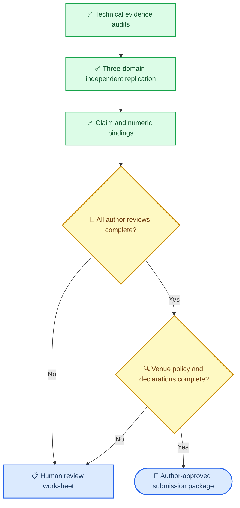

# Local-Cluster Submission Handoff

_An evidence-bound handoff for accountable author review, 2026-10-08_

---

## Evidence status

The local-cluster evidence package now has technical completion checks for the
frozen held-out confirmations, failed gates, inference boundary, external-code
extensions, claim/evidence bindings, and three independent-host target-domain
replications. The project-level replication summary keeps domain effects
separate rather than reporting a pooled effect.[^1]

The primary backbone is locked as the one-scan Mamba-1 local-cluster model.
Mamba-2 remains a validation-only ablation; stopped v13--v16 and Mamba-3
families are retained as negative/resource boundaries. See the
[backbone selection memo](final_backbone_selection_20261009.md).

An evidence-bound IMRAD writing outline is available at
[local-cluster manuscript outline](local_cluster_manuscript_outline_20261009.md).
A full Chinese working draft using the same current evidence line is available
at [local-cluster manuscript draft](local_cluster_acf_infonce_manuscript_draft_20261012.md).
The final review pack also has a file-level SHA-256 manifest generated by
`python scripts/verify_final_local_cluster_evidence.py`; reviewers should
record its `manifest_content_sha256` alongside their worksheet review.
The same command also fails closed if the current tracked source/data inputs
drift from the independent-host execution manifests.

| Independent target | Active vs null | Wins | One-SE upper |
| --- | ---: | ---: | ---: |
| PEMS-BAY H192, 10% | `-1.193%` | 3/3 | `.99151` |
| METR-LA H192, 10% | `-0.301%` | 3/3 | `.99762` |
| Weather H192, 10% | `-0.120%` | 3/3 | `.99903` |

The independently hosted, pinned official PatchTST extension is likewise
positive on all three targets, but remains post-release and descriptive:
PEMS-BAY `-0.412%`, METR-LA `-3.819%`, and Weather `-3.809%`, each with 3/3
paired active wins. It is not pooled with either the active/null effects or
the frozen primary comparison matrix.



## Required author actions

- [ ] Open and verify each of the nine rows in [the human verification worksheet](mambatsv3_acf_infonce_local_cluster_human_verification_worksheet_20261003.csv)
- [ ] Select a target journal and check its current manuscript, AI-use, data/code, and conflict-of-interest policies
- [ ] Confirm the author list and CRediT contributions
- [ ] Supply verified funding, conflict, ethics, data availability, code availability, and AI-use statements
- [ ] Decide which post-release external-code extensions are supplement-only
- [ ] Approve the final scope statement and retained negative boundaries

## Scope that must remain in the manuscript

- The supported result is conditional low-label H192 transfer on named periodic
  sensor targets, not universal multivariate forecasting
- Electricity and higher-coverage Traffic remain negative boundaries
- Weather H192 at 25% target labels remains a failed gate
- Independent replication directions are not pooled across domains
- The method has one Mamba scan and no relation loss at inference, but does not
  claim universal latency superiority

## Machine-readable handoff

Run the following after any evidence-package change:

```bash
python scripts/audit_local_cluster_submission_readiness.py
```

The generated `submission_readiness_20261008.json` intentionally remains
`submission_ready=false` until accountable humans complete the above actions.

[^1]: [Independent replication program audit](../../artifacts/reproducibility/mambatsv3_local_cluster_independent_replication_program_20261008/readout.md)
