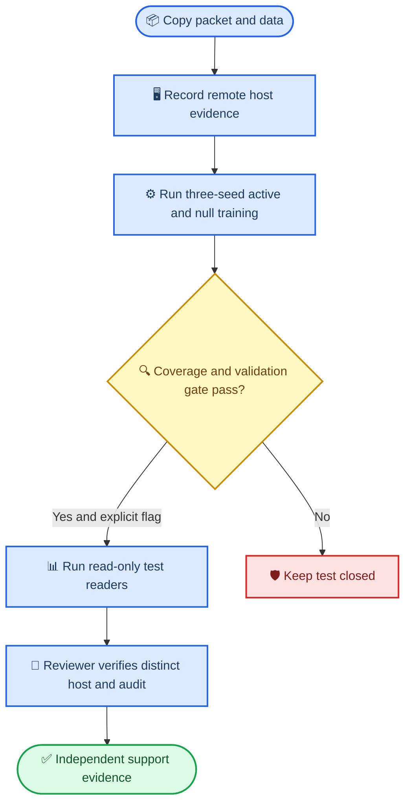

# Local-Cluster Independent-Machine Packet

_Portable PEMS-BAY H192 replication packet for external human-operated execution, 2026-10-08_

---

## Context

The local-cluster ACF-InfoNCE evidence package has six held-out active/null
confirmations. This packet froze a new three-seed PEMS-BAY H192/10%
replication of the central local-cluster active versus exact-null mechanism.
It was executed on a reviewer-verified separate host, while this document
retains the portable procedure and evidence boundary.

## Replication lifecycle



## Frozen contract

| Field | Value |
| --- | --- |
| Target | PEMS-BAY, H192, 10% target training prefix, chronological 60/20/20 split |
| Fresh seeds | `6130`, `6131`, `6132` |
| Source pool | PEMS07, PEMS08, PEMS04; PEMS-BAY excluded |
| Initialization | PEMS03 and PEMS04 frozen H12 checkpoints |
| Shared model | One-scan MambaTSv3 Mamba-1, `d_model=24`, patch `24/24` |
| Source objective | Last-value residual next-patch prediction plus signed forecast InfoNCE |
| Pair geometry | Train-only `contrastive_cluster`, channel support `>=0.5` |
| Active/null contrast | Relation fraction `.1` versus zero; all other source settings fixed |
| Test boundary | Test is closed by default and opens only after all validation gates pass and `--open-test-after-validation` is explicitly supplied |
| Thermal boundary | Guard at `78C` and `85%` fan for every stage |

## Remote execution

Run these commands only on a separately reviewed machine containing a copy of
the repository, data, and named initialization checkpoints.

```bash
python scripts/collect_independent_host_evidence.py \
  --ssh-host REMOTE_SSH_DESTINATION \
  --machine-id HOST_IDENTIFIER \
  --remote-python /absolute/path/to/python \
  --output artifacts/reproducibility/mambatsv3_local_cluster_independent_machine_20261008/host_evidence.json

python scripts/run_mambatsv3_local_cluster_independent_replication.py \
  --python /absolute/path/to/python \
  --machine-id HOST_IDENTIFIER \
  --open-test-after-validation

python scripts/audit_mambatsv3_local_cluster_independent_replication.py \
  --artifact-root artifacts/reproducibility/mambatsv3_local_cluster_independent_machine_20261008 \
  --verified-independent-machine-id HOST_IDENTIFIER \
  --host-evidence artifacts/reproducibility/mambatsv3_local_cluster_independent_machine_20261008/host_evidence.json
```

## Evidence boundary

- `--machine-id` is an operator claim, not proof of physical independence.
- The host-evidence collector makes only an SSH read-only metadata query and
  records whether the remote hostname differs from the auditor host. A reviewer
  must still establish that it is a separate physical machine.
- Code, data, sampler, and initialization checkpoint hashes are persisted in
  the remote manifest. A changed hash is evidence of a new replication
  environment, not a silent replay of the original artifact.
- The packet execution is now independent-machine support evidence: the remote
  host used a distinct RTX 3060 Ti, Torch `2.6.0+cu126`, and Mamba `2.2.4`.
  Its staging manifest matched all 14 tracked code, data, sampler, and
  initialization-checkpoint hashes.
- Fresh seeds `6130--6132` gave active/null test MSE `2.638441/2.670296`, a
  `-1.193%` paired change, 3/3 wins, and one-SE upper ratio `.99151`. All 18
  guarded stages completed without a trigger; maximum telemetry was `63C` and
  `31%` fan. The independent audit is
  `artifacts/reproducibility/mambatsv3_local_cluster_independent_machine_20261008/independent_audit.json`.
- The independent result is support evidence, not a pooled replacement for the
  six original held-out confirmation coordinates.
