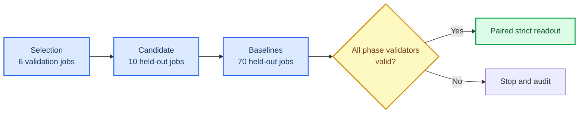

# Stride-24 High-Dimensional Held-out Readout (CPU-4 rerun)

_Human-review draft for the completed 2026-10-01 CPU-thread-limited held-out run._

---

## 📋 Scope

This is the completed CPU-thread-limited rerun of the frozen Electricity/Traffic multivariate H96 protocol. It contains 6 validation jobs, 10 candidate held-out jobs, and 70 same-source baseline held-out jobs. The candidate is `MambaTSv3AutoCon`, Mamba-1, `patch_len=patch_stride=24`, `d_model=32`, `d_ff=64`, `AutoCon_lambda=0.001`, with prediction-connected fusion disabled. Baselines are DLinear, NLinear, RLinear, PatchTST, TimesNet, iTransformer, and Mamba2.

- Plan: [`CPU-4 plan`](mambatsv3_stride24_relation_auxiliary_highdim_cpu4_test_release_20261001.json)
- Launch binding: [`CPU-4 authorization`](mambatsv3_stride24_relation_auxiliary_highdim_cpu4_test_release_20261001_launch_authorization.json)
- Strict machine readout: [`readout.md`](../../artifacts/paper_final/mambatsv3_stride24_relation_auxiliary_highdim_cpu4_test_release_20261001/readout/readout.md)
- Artifact root: [`CPU-4 artifacts`](../../artifacts/paper_final/mambatsv3_stride24_relation_auxiliary_highdim_cpu4_test_release_20261001/)

All three phase validators are valid: selection `6/6`, candidate `10/10`, and baselines `70/70`. The GPU guard completed with return code 0 and no thermal trigger.

## 📈 Held-out result

The primary comparison is paired streaming scaled MSE over five fresh seeds. The registered one-sided 95% upper ratio uses the `1.02` non-inferiority margin.

| Dataset | Baseline | Candidate change | Paired wins | Upper ratio | Gate |
| --- | --- | ---: | ---: | ---: | --- |
| Electricity H96 | DLinear | -17.293% | 5/5 | 0.8297 | Pass |
| Electricity H96 | NLinear | -17.306% | 5/5 | 0.8296 | Pass |
| Electricity H96 | RLinear | -17.283% | 5/5 | 0.8298 | Pass |
| Electricity H96 | PatchTST | -16.339% | 5/5 | 0.8393 | Pass |
| Electricity H96 | TimesNet | -7.784% | 5/5 | 0.9339 | Pass |
| Electricity H96 | iTransformer | -11.414% | 5/5 | 0.8898 | Pass |
| Electricity H96 | Mamba2 | -9.503% | 5/5 | 0.9154 | Pass |
| Traffic H96 | DLinear | -20.014% | 5/5 | 0.8136 | Pass |
| Traffic H96 | NLinear | -20.034% | 5/5 | 0.8133 | Pass |
| Traffic H96 | RLinear | -20.102% | 5/5 | 0.8126 | Pass |
| Traffic H96 | PatchTST | -5.783% | 5/5 | 0.9554 | Pass |
| Traffic H96 | TimesNet | -18.400% | 5/5 | 0.8365 | Pass |
| Traffic H96 | iTransformer | +2.154% | 1/5 | 1.0398 | **Fail** |
| Traffic H96 | Mamba2 | -17.339% | 5/5 | 0.8426 | Pass |

Thus, 13/14 registered cells pass the non-inferiority gate. The Traffic/iTransformer cell is an explicit counterexample and must remain in any paper table. The evidence does not support a universal superiority claim.

## 🌡️ Resource and thermal boundary

Fixed-shape FP32, device-resident prediction-only resource measurements used batch size 32, 25 warm-up forwards, and 100 timed forwards. AutoCon relation loss and returned representations were excluded. Candidate median latency was `0.3913 ms` on Electricity and `0.8366 ms` on Traffic. These are inference-shape measurements, not training throughput or universal speed claims.

Training GPU telemetry peaked at `57°C`, `35%` fan, and `301.2 W`; resource telemetry peaked at `48°C` and `222 W`. The CPU-limited runner injected `OMP_NUM_THREADS=4`, `MKL_NUM_THREADS=4`, `OPENBLAS_NUM_THREADS=4`, `NUMEXPR_NUM_THREADS=4`, and PyTorch intra-op 4/inter-op 1. Only one training process was active at a time.

## ⚠️ Interpretation boundary

The defensible claim is restricted to this frozen five-seed Electricity/Traffic H96 protocol: relation-auxiliary AutoCon training was non-inferior to 13 of 14 registered baseline cells and showed lower paired streaming MSE in those cells. It did not beat Traffic/iTransformer, and this release does not establish causality of the AutoCon loss, long-horizon behavior, graph-aware forecasting, universal accuracy, or hardware-independent efficiency.

The previous high-thread partial run is operationally retained for audit only and is excluded from this readout. Its artifacts must not be pooled with the CPU-4 rerun.
