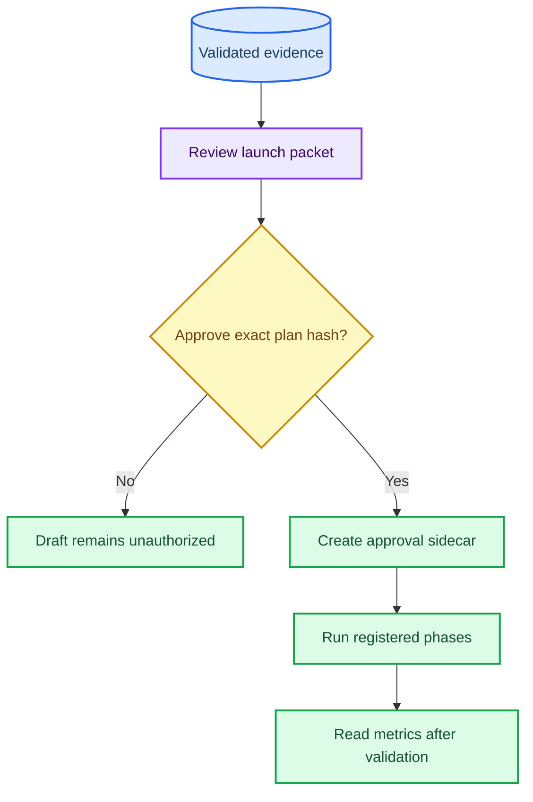

# Stride-24 High-Dimensional Held-out Launch Review

_Superseded launch packet. The original high-thread draft was stopped and replaced by the completed CPU-4 rerun documented in [`stride24_highdim_cpu4_heldout_readout_20261001.md`](stride24_highdim_cpu4_heldout_readout_20261001.md)._ 

---

## Decision

This file is retained as the prelaunch review for the original draft. It is not the authoritative result record. Use the CPU-4 readout linked above for completed held-out metrics and resource telemetry.

This review concerns only the registered stride-24 held-out draft. It is an alternative to, not an extension of, the existing stride-8 high-dimensional draft. Authorizing either plan does not authorize the other.

| Item | Registered value |
| --- | --- |
| Plan | [stride-24 held-out draft](mambatsv3_stride24_relation_auxiliary_highdim_test_release_draft_20261001.json) |
| Plan SHA-256 | `49ff3b8ce004487a4e1b88c0463a1a06f39d23b71af034b4f321595a3250aa98` |
| Status | `launch_authorized`, `execution.authorized=true` |
| Scope | Electricity and Traffic, multivariate H96 |
| Candidate | MambaTSv3AutoCon, Mamba-1, `patch_len=patch_stride=24`, `d_model=32`, `d_ff=64`, `AutoCon_lambda=.001`, fusion disabled |
| Comparison set | DLinear, NLinear, RLinear, PatchTST, TimesNet, iTransformer, Mamba2 |
| Validation seeds | `3361--3363` |
| Confirmation seeds | `3371--3375` |
| Registered workload | 6 validation reproducibility jobs, 10 candidate test jobs, 70 baseline test jobs; 86 total |
| Runner preflight | `--validate_only` expands all 86 jobs |

## Validation Evidence

The candidate is validation-only evidence, not held-out evidence. The table lists the completed same-source three-seed matrix and matched resource protocol.

| Dataset | Candidate MSE | Strongest comparator | Candidate change | Paired wins | Fixed-shape latency | Efficiency boundary |
| --- | ---: | --- | ---: | ---: | ---: | --- |
| Electricity H96 | `.163764` | TimesNet `.169600` | `-3.438%` | `3/3` against each of 6 baselines | `.3971 ms` | Faster than PatchTST, Mamba-1, TimesNet, Mamba2; slower than DLinear and iTransformer |
| Traffic H96 | `.384616` | iTransformer `.402049` | `-4.332%` | `3/3` against each of 6 baselines | `.8379 ms` | Faster than PatchTST, iTransformer, TimesNet, Mamba2; slower than DLinear and Mamba-1 |

The current-source resource preflight independently reports `.38858/.83901 ms`, consistent with the frozen resource attestation. These are device-resident synthetic forward measurements on RTX 5090 D, not training throughput or a universal speed claim.

## AutoCon And Source Continuity

| Check | Result | Evidence |
| --- | --- | --- |
| AutoCon participation | All six candidate logs have finite nonzero contrastive loss and `effective_lambda=.001` | [AutoCon audit](../../artifacts/exploratory/mambatsv3_stride24_highdim_autocon_training_audit_20261001/readout/readout.md) |
| Objective identity | Maximum `train_loss = mse_loss + lambda * autocon_loss` residual is `9.61e-10` | Same AutoCon audit |
| Default-path equivalence | Frozen snapshot/current state and prediction hashes match exactly | [Equivalence audit](../../artifacts/exploratory/mambatsv3_stride24_default_path_equivalence_20261001/readout.md) |
| Representation equivalence | Maximum absolute difference `3.5763e-7`, below `2e-6` FP32 tolerance | Same equivalence audit |
| Historical validation source | Immutable source-tree SHA-256 `1e3976666f8971abe3bf884f2635bbaf57f522d327201f183647544a666a63a5` | [Candidate provenance](../../artifacts/exploratory/mambatsv3_stride24_relation_auxiliary_h96_validation_20260929/candidate/provenance.json) |

These checks prove objective participation and default-path continuity. They do not prove that the contrastive objective independently caused the accuracy result.

## Authorization Evidence Hashes

An approval sidecar must bind the exact plan hash above and include SHA-256 evidence for every prelaunch gate. The following local hashes are the evidence values reviewed for this draft.

| Required gate | Evidence artifact | SHA-256 |
| --- | --- | --- |
| Verify data fingerprints and 86-job expansion | [Plan](mambatsv3_stride24_relation_auxiliary_highdim_test_release_draft_20261001.json) and local dataset hashes | Plan hash above; Electricity `7e45845d54c5219bad0ae6bc1b5316cf8ff9cead5d33fa998a5a51c2e4a497ad`; Traffic `cb06463d56fa17d87f47027cd9389ceae82a69eddee51cdb61480e120dab0b16` |
| Freeze candidate, AutoCon audit and comparators | [Full validation readout](../../artifacts/exploratory/mambatsv3_stride24_full_baseline_h96_validation_20260929/readout/readout.md), [AutoCon audit](../../artifacts/exploratory/mambatsv3_stride24_highdim_autocon_training_audit_20261001/readout/readout.md) | `51f1cbe2797e00fc2fce1075e362af3d8f8e017bebd4c573e503250aace597ce`; `497d38810152e56a7acbba5c80c119fb46c3a9349bf0bad90f38e689e7efa5cb` |
| Verify default-path equivalence | [Equivalence audit JSON](../../artifacts/exploratory/mambatsv3_stride24_default_path_equivalence_20261001/audit.json) | `5ec8d710a90813caccd592e1510f3ba1a0bcb5b1e3611353b8f086956fd73176` |
| Review efficiency boundary | [Full resource attestation](../../artifacts/exploratory/mambatsv3_stride24_full_baseline_resource_20260929/readout/readout.md) | `25466a43175168fa9dcd88e49a409f891ef324e1bf360def90ba0eee0e50e3ca` |
| Bind exact plan approval | [Plan](mambatsv3_stride24_relation_auxiliary_highdim_test_release_draft_20261001.json) and [authorization sidecar](mambatsv3_stride24_relation_auxiliary_highdim_test_release_20261001_launch_authorization.json) | `49ff3b8ce004487a4e1b88c0463a1a06f39d23b71af034b4f321595a3250aa98` |

## Release Rules

1. The human authorization is bound only to the exact plan SHA-256 above through the linked sidecar.
2. The runner must preserve one immutable source snapshot across all three phases.
3. The selection phase remains validation-only and must complete before test metrics are read.
4. The strict reader reports five-seed paired one-sided 95% log-MSE upper ratios against the `1.02` non-inferiority margin.
5. All 14 dataset-baseline cells, including failures, must be reported. No held-out result may select architecture, patch stride, lambda, comparator set or resource protocol.
6. Resource claims remain limited to named comparators, fixed RTX 5090 D shapes, FP32 and device-resident prediction-only forwards.

## Risks

- The stride-24 candidate has validation MSE `3.494%/3.135%` above the stride-8 candidate, despite being faster on the measured shapes.
- A validation advantage may not reproduce on untouched test windows.
- The candidate is not faster than DLinear in either high-dimensional shape and is not a universal speed winner.
- AutoCon participation is verified, but independent causal accuracy benefit remains unproven.
- The result would apply only to Electricity/Traffic H96 under this protocol.

## Related Records

- [Candidate tradeoff review](highdim_candidate_tradeoff_review_20261001.md)
- [Existing stride-8 held-out review](highdim_heldout_review_20260929.md)
- [Research completion audit](research_goal_completion_audit_20260928.md)
- [Submission readiness audit](../../artifacts/exploratory/submission_readiness_audit_20261001/audit.json)
